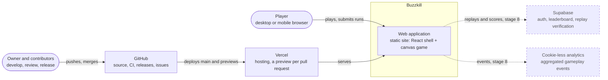
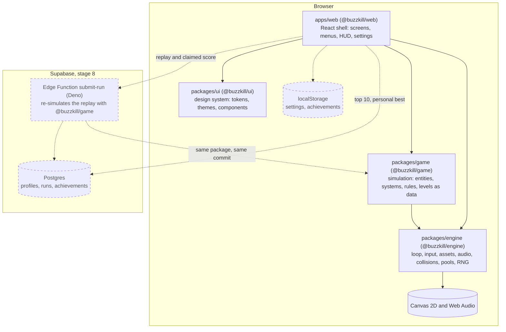
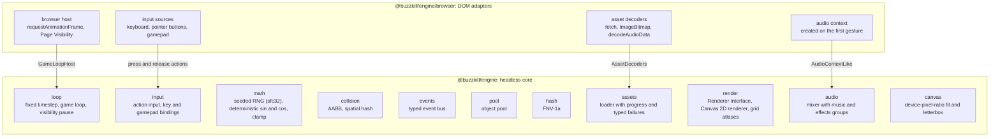
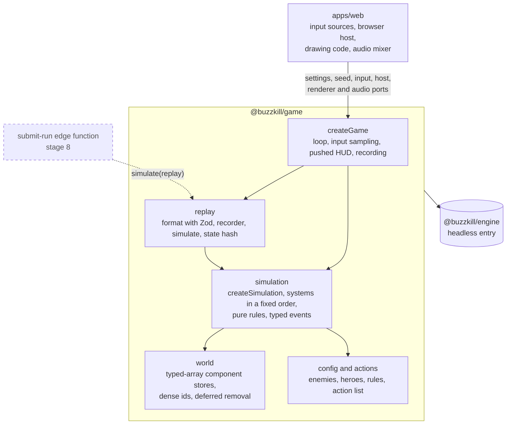
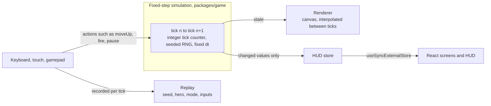
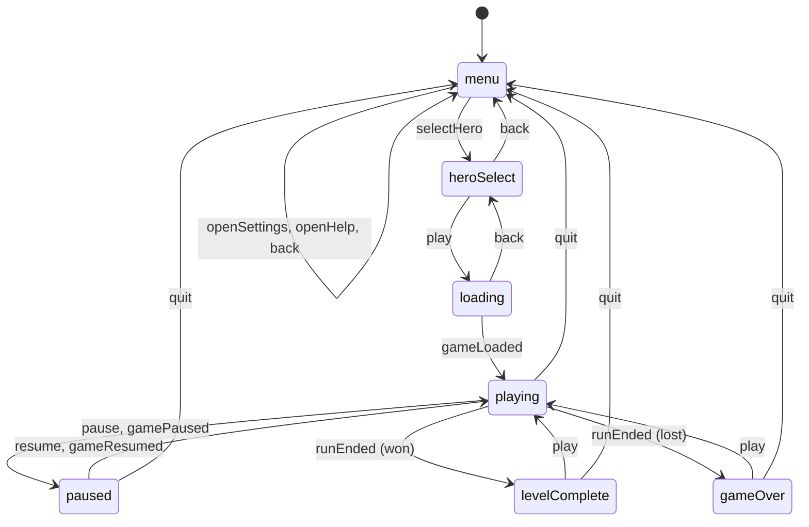

# Architecture

Buzzkill is a browser game: a headless simulation drawn on a canvas, wrapped in a React shell.
This page is the map. The decisions behind it, with the alternatives that were rejected, live in the
[ADRs](adr/README.md).

The diagrams follow the [C4 model](https://c4model.com): **Context** (who uses the system and what
it talks to), **Container** (the runnable and deployable parts) and, from stage 3 on, **Component**
views of the engine and the game. Dashed elements are planned but not built yet; the table at the
end says what exists today.

## Level 1: system context

## Level 2: containers

### Dependency rules

| From       | May import             | Never imports                                 |
| ---------- | ---------------------- | --------------------------------------------- |
| `apps/web` | `game`, `engine`, `ui` | internals of any package (`src/…`)            |
| `game`     | `engine` (main entry)  | `engine/browser`, `ui`, `web`, React, the DOM |
| `engine`   | nothing in the repo    | `game`, `ui`, `web`, React                    |
| `ui`       | nothing in the repo    | `engine`, `game`, `web`                       |

The rules are enforced three times over:

1. **pnpm**: a package can only import what its `package.json` declares.
2. **dependency-cruiser** (`pnpm lint:repo`): `engine-is-standalone`, `engine-core-is-headless`,
   `game-depends-only-on-engine`, `ui-knows-nothing-about-game`, `no-deep-imports` (other packages
   only through their declared entries), `no-circular`, `no-orphans`, `not-to-test`,
   `not-to-unresolvable`.
3. **ESLint and TypeScript** for `packages/game` and the main entry of `packages/engine`: no DOM lib in
   their `tsconfig.json`; the engine's DOM adapters (animation-frame host, keyboard, pointer
   buttons, gamepad) live in `src/browser` behind the `@buzzkill/engine/browser` entry with a
   tsconfig of their own, and only `apps/web` imports them. For the game, ESLint also bans
   `window`, `document`, `fetch`, `Math.random`, `Date.now`, `performance.now` and transcendental
   `Math` functions, so the simulation stays headless and deterministic.

Packages export TypeScript source (`"exports": { ".": "./src/index.ts" }`); Vite consumes it
directly and there is no per-package build step.

## Level 3: components

### Engine

The engine is the reusable part: nothing in it knows Buzzkill. Its main entry compiles without the
DOM lib; everything that touches the browser sits behind `@buzzkill/engine/browser` and is
handed to the core through small interfaces, which is also how tests replace it.

The renderer and the mixer are typed against the part of the 2D context and of Web Audio they use,
so they belong to the headless core even though only a browser runs them (ADR-0004).

### Game

The game is Buzzkill's rules as data plus pure systems over an ECS-lite world (ADR-0003). It
imports only the engine's headless entry, so the same build runs in the browser and, in stage 8,
in the server function that verifies a replay (ADR-0009).

- `createGame` is the only thing the shell calls: it drives the simulation with the engine loop,
  samples input once per tick, records the replay and publishes the HUD when a value changes.
- `simulate` replays a run without a loop, a DOM or a clock and returns the score and an FNV-1a
  hash of the whole state; a replay recorded in the browser gives the same hash.
- The world never draws itself: the shell's drawing code reads it through the `GameRenderer` port
  and interpolates between ticks.

## Runtime data flow

- **Simulation time is a tick counter.** The engine loop advances the simulation in fixed steps
  (60 Hz is the working assumption) and renders in between with interpolation, so game speed does
  not depend on the monitor's refresh rate. The tab pausing on `visibilitychange` is an engine
  concern, not a game concern.
- **Input is an abstraction of actions, not keys.** Keyboard, touch and gamepad all produce the same
  action set, which makes key remapping and replays trivial: a replay stores only the changes of the
  pressed-action set per tick together with the seed.
- **Determinism** (ADR-0009, stage 3): the same seed and input sequence must produce bit-identical
  results in every browser and in Node or Deno. That is what lets the leaderboard verify a claimed
  score by re-running the replay on the server with the same `@buzzkill/game` build.
- **HUD updates are pushed, not polled.** The simulation publishes score, lives and ammo to a small
  external store only when a value changes; React subscribes with `useSyncExternalStore` and
  selectors, so a 60 Hz simulation never causes 60 React renders per second. Each value of the
  HUD subscribes through its own selector (`useGameHud`, #109): a shot renders the ammo and
  nothing else, and the shell, the canvas and the HUD frame do not render during play. A test
  under the React Profiler API counts this over ten seconds of play: 32 publications, 32 commits,
  no render of `App`, `GameView` or `GameHud`.

### State layers

| State                                                            | Lives in   | Tool                                                                                                                  |
| ---------------------------------------------------------------- | ---------- | --------------------------------------------------------------------------------------------------------------------- |
| Simulation (positions, enemies, projectiles)                     | `game`     | Mutable structures, no reactivity; updated every tick                                                                 |
| Application flow (menu, hero select, playing, paused, game over) | `apps/web` | Typed state machine of our own: `transition(state, event)` and a store read through `useSyncExternalStore` (ADR-0006) |
| HUD (score, lives, ammo)                                         | bridge     | `game.subscribe` and `game.getHud` read through `useSyncExternalStore`, one selector per value (#109)                 |
| Settings (volume, theme, controls, language)                     | `apps/web` | The same store, a Zod schema with `version` and migrations, `localStorage` (ADR-0006, #110)                           |
| Strings of the current language                                  | `apps/web` | A typed dictionary per language with `Intl` formatters, one React context value per language (ADR-0013, #111)         |
| Loading of the game (code and files)                             | `apps/web` | A store of its own beside the flow: `idle`, `loading`, `codeFailed`, `assetsFailed`, `ready` (#112)                   |
| Server state (leaderboard, profile)                              | `apps/web` | TanStack Query (stage 8)                                                                                              |
| URL                                                              | `apps/web` | `?seed=`, `?debug=1` for reproducible bugs and demos                                                                  |

### Application flow

The flow is a state machine of our own (ADR-0006): `transition(state, event)` in
`apps/web/src/state/machine.ts`, held by a store that React reads through `useSyncExternalStore`.
The flow starts on the menu, before the game has downloaded; `menu` says which of its panels is
open (the main menu, the settings or the help). `loading` holds the run the player chose while the
game finishes loading; the four run states carry the loaded assets and the run, and the two final
ones its result, so a pause dialog on the menu or a game over without a run cannot be written.
`gameLoaded` is the end of the loading; `gamePaused`, `gameResumed` and `runEnded` are what the
game reports through the bridge; the other events are the player's actions. A test keeps this
diagram honest: it must name every state and draw exactly the transitions of the table.

### Loading on demand

The menu is the first thing on screen; the code of a run and its files download after it (#112).
The main chunk holds the shell: React, the design system, the screens, the settings, the
dictionaries and the small part of the game they read (the actions, the default keys, the rules).
The game chunk holds the rest: the game view with `createGame`, the simulation, the loop, the
renderer, the input sources and the HUD, the drawing code, the asset manifest and its loading.
`src/game/import-chunk.ts` is the only door to it, a dynamic `import()`, and dependency-cruiser
rejects a static import of its modules from the rest of the shell. The menus and the game view
both import the barrels of `@buzzkill/game` and `@buzzkill/engine`; both packages declare
`"sideEffects": false`, so the bundler leaves out of the main chunk every module the menus do not
use.

The game loader (`src/state/game-loader.ts`) is a store apart from the flow, because loading goes
on while the player moves between screens: `idle`, `loading` with the progress of the files,
`codeFailed`, `assetsFailed` and `ready`. Hovering or focusing Play starts it, and so do the Play
click, which touch screens give without a hover, and Start. When the player starts a run before
it is ready, `loading` shows the progress; when it is ready, the run starts without a wait.
`React.lazy` renders the game view from the same chunk, so the code downloads once. A failed file
can be loaded again; a missing chunk, which is what an old page meets after a new deploy, needs
a reload of the page.

The loader creates the page's audio context in the main chunk, before any gesture, so that the
sounds can be decoded on it. Start resumes it inside the click, which every browser accepts as the
gesture that starts audio, even when the game has not finished loading yet.

## What exists today

Stages 1 to 3 are done: the repository, the import of the 2023 game, and its rebuild as an engine
and a deterministic simulation. Dashed elements in the diagrams are later stages.

| Container         | Today                                                                                                                                                                                                                                                                                                                                                                                                                                                                                                                                                                                                                                                                                                                                                                                                                                                                                                                                 |
| ----------------- | ------------------------------------------------------------------------------------------------------------------------------------------------------------------------------------------------------------------------------------------------------------------------------------------------------------------------------------------------------------------------------------------------------------------------------------------------------------------------------------------------------------------------------------------------------------------------------------------------------------------------------------------------------------------------------------------------------------------------------------------------------------------------------------------------------------------------------------------------------------------------------------------------------------------------------------- |
| `apps/web`        | The application state machine with its store and the bridge from the game (#107); the screens on the design system (#108), every string from a typed dictionary in English and Russian that follows the language setting without a reload (ADR-0013, #111): the main menu, the hero select, the settings (sound, theme, language, difficulty and the keys, saved in `localStorage` under a versioned Zod schema with migrations, #110) and the help with the player's controls, with the gamepad moving focus between the controls; the menu before the game, whose code and files load as a chunk of their own from the first hover or focus of Play, with a loading screen for progress and failures (#112); the game through `createGame` with the Canvas 2D renderer, Web Audio, keyboard and gamepad (#64); the React HUD with one subscription per value (#109) and the pause, level-complete and game-over dialogs on `Dialog` |
| `packages/engine` | Fixed-step loop (#33); seeded RNG, deterministic trig, AABB + spatial hash, pools, event bus, canvas fit (#37); action input for keyboard, touch and gamepad (#34); asset loader with progress, grid atlases and the Canvas 2D renderer (#35, #63); Web Audio mixer with volume groups (#36)                                                                                                                                                                                                                                                                                                                                                                                                                                                                                                                                                                                                                                          |
| `packages/game`   | Headless simulation: ECS-lite world, systems, enemies and rules as data (#38, #39); game actions and bindings (#34); `createGame` with injected dependencies and a pushed HUD (#40); replay recording, the Zod-validated replay format, `simulate` and golden replays (#41).                                                                                                                                                                                                                                                                                                                                                                                                                                                                                                                                                                                                                                                          |
| `packages/ui`     | Design tokens in three layers from one TypeScript source (#74), rendered to the `@buzzkill/ui/tokens.css` export; the day and night themes with the user's preferences (#75); Storybook with the token and theme docs (#76); the layout and text primitives `Stack`, `Inline`, `VisuallyHidden` and `KeyHint` (#78), styled with CSS Modules whose class types `cmk` generates; `Button`, `IconButton`, `Dialog`, `Menu`, `Switch`, `Slider`, `RadioGroup`, `Tabs` and `Toast`, each after its WAI-ARIA pattern with a controlled and an uncontrolled mode (#79 to #84); the Accessibility page with every pattern, the focus rules and a keyboard walkthrough, guarded by axe and a focus-style test (#77)                                                                                                                                                                                                                           |
| `packages/config` | `tsconfig.base.json`, Vitest presets (`node`, `jsdom`)                                                                                                                                                                                                                                                                                                                                                                                                                                                                                                                                                                                                                                                                                                                                                                                                                                                                                |
| Supabase          | Not started (stage 8)                                                                                                                                                                                                                                                                                                                                                                                                                                                                                                                                                                                                                                                                                                                                                                                                                                                                                                                 |

Stage 2 imported the original engine from the team project as `packages/game/src/legacy/` with its
history and pinned its behavior with characterization tests. Stage 3 rebuilt it as the engine and
the simulation above and deleted the folder (#42); the 2023 commits stay in the git history, and
the simulation, replay and golden tests now pin the behavior.

## Read next

- [Architecture Decision Records](adr/README.md): monorepo tooling, UI framework, entity model,
  rendering, determinism and replays, hosting, releases, benchmarks in CI.
- [CONTRIBUTING](../CONTRIBUTING.md): how to run the project and how changes get in.
- [CLAUDE.md](../CLAUDE.md): the rules AI coding agents follow in this repository.
