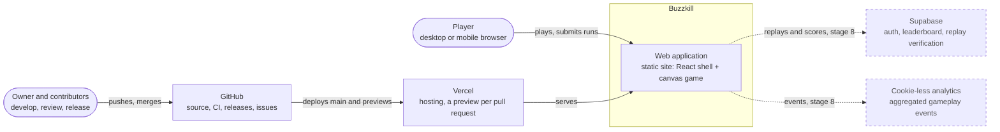
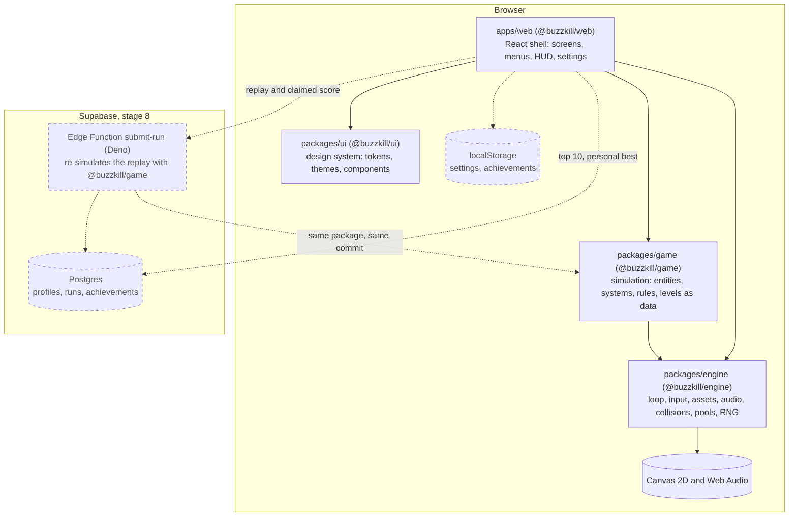
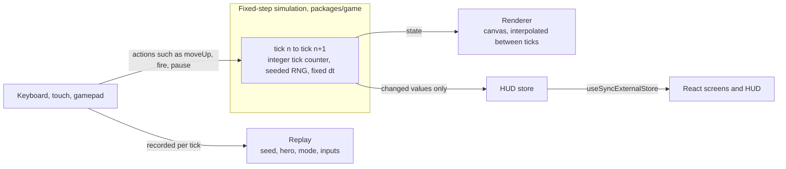

# Architecture

Buzzkill is a browser game: a headless simulation drawn on a canvas, wrapped in a React shell.
This page is the map. The decisions behind it, with the alternatives that were rejected, live in the
[ADRs](adr/README.md).

The diagrams follow the [C4 model](https://c4model.com): **Context** (who uses the system and what
it talks to), **Container** (the runnable and deployable parts) and, from stage 3 on, **Component**
views of the engine and the game. Dashed elements are planned but not built yet; the table at the
end says what exists today.

## Level 1: system context

## Level 2: containers

### Dependency rules

| From       | May import             | Never imports                      |
| ---------- | ---------------------- | ---------------------------------- |
| `apps/web` | `game`, `engine`, `ui` | internals of any package (`src/…`) |
| `game`     | `engine`               | `ui`, `web`, React, the DOM        |
| `engine`   | nothing in the repo    | `game`, `ui`, `web`, React         |
| `ui`       | nothing in the repo    | `engine`, `game`, `web`            |

The rules are enforced three times over:

1. **pnpm**: a package can only import what its `package.json` declares.
2. **dependency-cruiser** (`pnpm lint:repo`): `engine-is-standalone`, `game-depends-only-on-engine`,
   `ui-knows-nothing-about-game`, `no-deep-imports` (other packages only through `src/index.ts`),
   `no-circular`, `no-orphans`, `not-to-test`, `not-to-unresolvable`.
3. **ESLint and TypeScript** for `packages/game`: no DOM lib in its `tsconfig.json`, and ESLint bans
   `window`, `document`, `fetch`, `Math.random`, `Date.now`, `performance.now` and transcendental
   `Math` functions, so the simulation stays headless and deterministic.

Packages export TypeScript source (`"exports": { ".": "./src/index.ts" }`); Vite consumes it
directly and there is no per-package build step.

## Runtime data flow

- **Simulation time is a tick counter.** The engine loop advances the simulation in fixed steps
  (60 Hz is the working assumption) and renders in between with interpolation, so game speed does
  not depend on the monitor's refresh rate. The tab pausing on `visibilitychange` is an engine
  concern, not a game concern.
- **Input is an abstraction of actions, not keys.** Keyboard, touch and gamepad all produce the same
  action set, which makes key remapping and replays trivial: a replay stores only the changes of the
  pressed-action set per tick together with the seed.
- **Determinism** (ADR-0009, stage 3): the same seed and input sequence must produce bit-identical
  results in every browser and in Node or Deno. That is what lets the leaderboard verify a claimed
  score by re-running the replay on the server with the same `@buzzkill/game` build.
- **HUD updates are pushed, not polled.** The simulation publishes score, lives and ammo to a small
  external store only when a value changes; React subscribes with `useSyncExternalStore` and
  selectors, so a 60 Hz simulation never causes 60 React renders per second.

### State layers

| State                                                            | Lives in   | Tool                                                    |
| ---------------------------------------------------------------- | ---------- | ------------------------------------------------------- |
| Simulation (positions, enemies, projectiles)                     | `game`     | Mutable structures, no reactivity; updated every tick   |
| Application flow (menu, hero select, playing, paused, game over) | `apps/web` | Finite state machine (ADR-0006, stage 5)                |
| HUD (score, lives, ammo)                                         | bridge     | External store + `useSyncExternalStore`                 |
| Settings (volume, theme, controls, language)                     | `apps/web` | Small store + `localStorage`, versioned schema with Zod |
| Server state (leaderboard, profile)                              | `apps/web` | TanStack Query (stage 8)                                |
| URL                                                              | `apps/web` | `?seed=`, `?debug=1` for reproducible bugs and demos    |

## What exists today

Stage 1 (foundation) is about the repository, not the game. The diagrams above show the target.

| Container         | Today                                                            |
| ----------------- | ---------------------------------------------------------------- |
| `apps/web`        | Vite + React 19 app that renders an empty full-screen canvas     |
| `packages/engine` | `clamp()` with property-based tests; the rest arrives in stage 3 |
| `packages/game`   | Empty public API; headless by configuration and by test          |
| `packages/ui`     | Empty public API; tokens and components arrive in stage 4        |
| `packages/config` | `tsconfig.base.json`, Vitest presets (`node`, `jsdom`)           |
| Supabase          | Not started (stage 8)                                            |

Stage 2 imports the original engine from the team project as `packages/game/src/legacy/` with its
history and pins its behavior with characterization tests; stage 3 refactors it into the structure
above.

## Read next

- [Architecture Decision Records](adr/README.md): monorepo tooling, UI framework, hosting, releases,
  and the stage 3 decisions to come (entity model, rendering, determinism).
- [CONTRIBUTING](../CONTRIBUTING.md): how to run the project and how changes get in.
- [CLAUDE.md](../CLAUDE.md): the rules AI coding agents follow in this repository.
