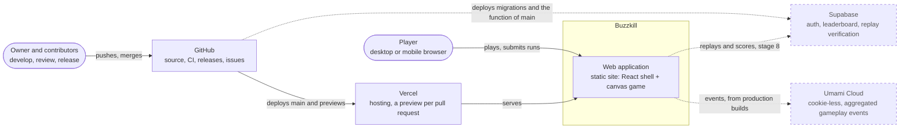
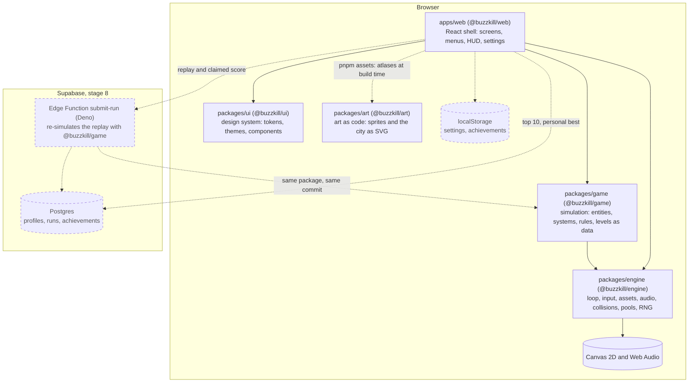
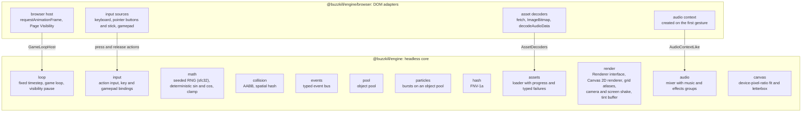
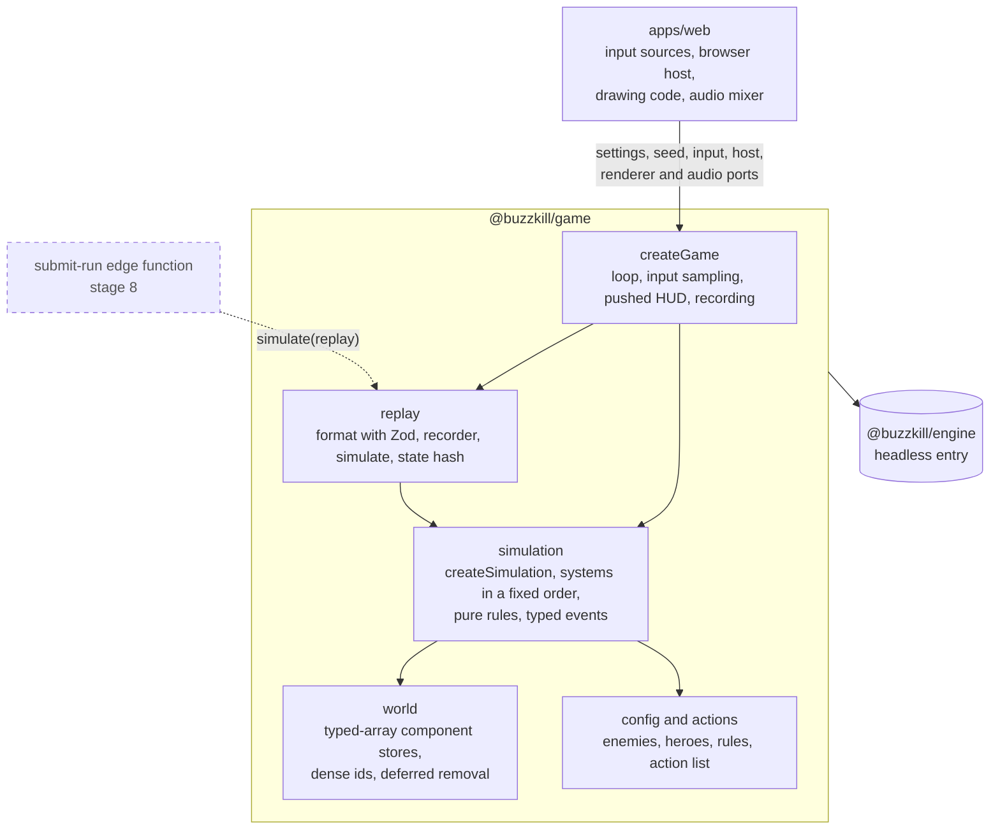
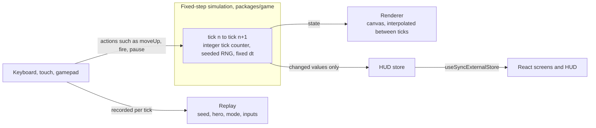
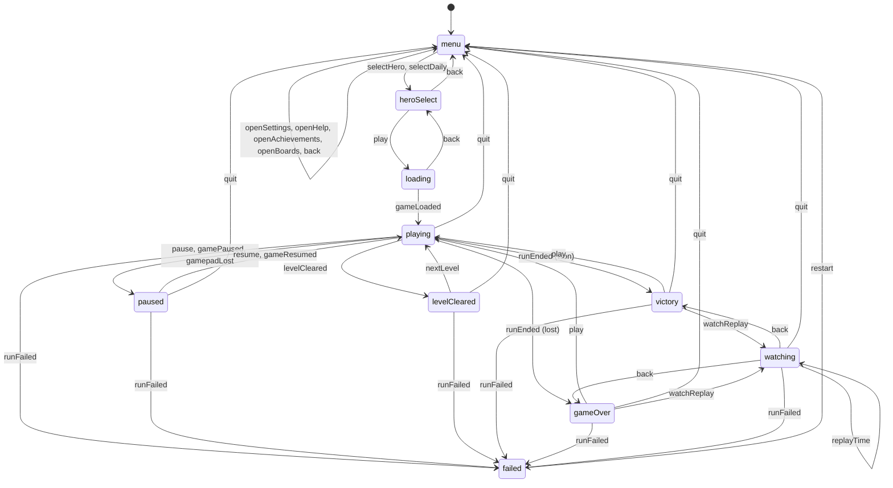

# Architecture

Buzzkill is a browser game: a headless simulation drawn on a canvas, wrapped in a React shell.
This page is the map. The decisions behind it, with the alternatives that were rejected, live in the
[ADRs](adr/README.md).

The diagrams follow the [C4 model](https://c4model.com): **Context** (who uses the system and what
it talks to), **Container** (the runnable and deployable parts) and, from stage 3 on, **Component**
views of the engine and the game. Dashed elements are planned but not built yet; the table at the
end says what exists today.

## Level 1: system context

## Level 2: containers

### Dependency rules

| From       | May import             | Never imports                                                   |
| ---------- | ---------------------- | --------------------------------------------------------------- |
| `apps/web` | `game`, `engine`, `ui` | internals of any package (`src/…`); `art`, except its scripts   |
| `game`     | `engine` (main entry)  | `engine/browser`, `ui`, `web`, React, the DOM                   |
| `engine`   | nothing in the repo    | `game`, `ui`, `web`, React                                      |
| `ui`       | nothing in the repo    | `engine`, `game`, `web`                                         |
| `art`      | nothing in the repo    | `engine`, `game`, `ui`, `web` (its tests read the game's sizes) |

The rules are enforced three times over:

1. **pnpm**: a package can only import what its `package.json` declares.
2. **dependency-cruiser** (`pnpm lint:repo`): `engine-is-standalone`, `engine-core-is-headless`,
   `game-depends-only-on-engine`, `ui-knows-nothing-about-game`, `art-is-standalone`,
   `web-loads-art-as-files` (only `apps/web/scripts` imports the art; the game loads atlases),
   `no-deep-imports` (other packages
   only through their declared entries), `no-circular`, `no-orphans`, `not-to-test`,
   `not-to-unresolvable`.
3. **ESLint and TypeScript** for `packages/game` and the main entry of `packages/engine`: no DOM lib in
   their `tsconfig.json`; the engine's DOM adapters (animation-frame host, keyboard, pointer
   buttons and stick, gamepad) live in `src/browser` behind the `@buzzkill/engine/browser` entry
   with a tsconfig of their own, and only `apps/web` imports them. For the game, ESLint also bans
   `window`, `document`, `fetch`, `Math.random`, `Date.now`, `performance.now` and transcendental
   `Math` functions, so the simulation stays headless and deterministic.

Packages export TypeScript source (`"exports": { ".": "./src/index.ts" }`); Vite consumes it
directly and there is no per-package build step.

## Level 3: components

### Engine

The engine is the reusable part: nothing in it knows Buzzkill. Its main entry compiles without the
DOM lib; everything that touches the browser sits behind `@buzzkill/engine/browser` and is
handed to the core through small interfaces, which is also how tests replace it.

The renderer and the mixer are typed against the part of the 2D context and of Web Audio they use,
so they belong to the headless core even though only a browser runs them (ADR-0004).

### Game

The game is Buzzkill's rules as data plus pure systems over an ECS-lite world (ADR-0003). It
imports only the engine's headless entry, so the same build runs in the browser and, in stage 8,
in the server function that verifies a replay (ADR-0009).

- `createGame` is the only thing the shell calls: it drives the simulation with the engine loop,
  samples input once per tick, records the replay and publishes the HUD when a value changes.
- `simulate` replays a run without a loop, a DOM or a clock and returns the score and an FNV-1a
  hash of the whole state; a replay recorded in the browser gives the same hash.
- The world never draws itself: the shell's drawing code reads it through the `GameRenderer` port
  and interpolates between ticks. Effects that only draw, such as the particles, follow the run's
  events through the same port's `listen`, which can subscribe to them but not emit them (#156).
  So does the screen shake, which moves the camera of the whole frame (#157), and so do the flashes
  of hits, which tint the same sprite on a spare canvas (#159), and the hit-stop, whose frames draw
  nothing for a moment after a strong blow while the ticks go on (#158).
- The achievements follow the same events through `createGame`'s `followers` (#163): `ACHIEVEMENTS`
  in `packages/game` is data, each a goal and pure counts over the events and what the run has
  seen. The shell keeps the progress in `localStorage` under a versioned schema, in a store the
  shell itself does not subscribe to, so a counted insect renders nothing but a toast for news.
- Sounds and haptics are ports the run calls on its events, `GameAudio` and the optional
  `GameHaptics`: a hit on the hero plays the hit sound and, on a phone that can, a short vibration
  through the Vibration API (#162), and a rumble of every gamepad that can (#154). Without the port,
  where nothing can vibrate, the run is the same. A sound carries the x of its event; the shell
  places it between the speakers by that x and moves its pitch a little each time, on random
  numbers of its own, so the replay does not change (#161).

## Runtime data flow

- **Simulation time is a tick counter.** The engine loop advances the simulation in fixed steps
  (60 Hz is the working assumption) and renders in between with interpolation, so game speed does
  not depend on the monitor's refresh rate. The tab pausing on `visibilitychange` is an engine
  concern, not a game concern.
- **Input is an abstraction of actions, not keys.** Keyboard, touch and gamepad all produce the same
  action set, which makes key remapping and replays trivial: a replay stores only the changes of the
  pressed-action set per tick together with the seed.
- **Determinism** (ADR-0009, stage 3): the same seed and input sequence must produce bit-identical
  results in every browser and in Node or Deno. That is what lets the leaderboard verify a claimed
  score by re-running the replay on the server with the same `@buzzkill/game` build.
- **HUD updates are pushed, not polled.** The simulation publishes score, lives and ammo to a small
  external store only when a value changes; React subscribes with `useSyncExternalStore` and
  selectors, so a 60 Hz simulation never causes 60 React renders per second. Each value of the
  HUD subscribes through its own selector (`useGameHud`, #109): a shot renders the ammo and
  nothing else, and the shell, the canvas and the HUD frame do not render during play. A test
  under the React Profiler API counts this over ten seconds of play: 32 publications, 32 commits,
  no render of `App`, `GameView` or `GameHud`.

### State layers

| State                                                            | Lives in   | Tool                                                                                                                  |
| ---------------------------------------------------------------- | ---------- | --------------------------------------------------------------------------------------------------------------------- |
| Simulation (positions, enemies, projectiles)                     | `game`     | Mutable structures, no reactivity; updated every tick                                                                 |
| Application flow (menu, hero select, playing, paused, game over) | `apps/web` | Typed state machine of our own: `transition(state, event)` and a store read through `useSyncExternalStore` (ADR-0006) |
| HUD (score, lives, ammo)                                         | bridge     | `game.subscribe` and `game.getHud` read through `useSyncExternalStore`, one selector per value (#109)                 |
| Settings (volume, theme, motion, game speed, controls, language) | `apps/web` | The same store, a Zod schema with `version` and migrations, `localStorage` (ADR-0006, #110)                           |
| Strings of the current language                                  | `apps/web` | A typed dictionary per language with `Intl` formatters, one React context value per language (ADR-0013, #111)         |
| Loading of the game (code and files)                             | `apps/web` | A store of its own beside the flow: `idle`, `loading`, `codeFailed`, `assetsFailed`, `ready` (#112)                   |
| Announcements for screen readers                                 | `apps/web` | The latest message in a small store, read by two live regions that stay in the page (#114)                            |
| Server state (leaderboard, profile)                              | `apps/web` | TanStack Query (stage 8)                                                                                              |
| URL                                                              | `apps/web` | `?seed=`, `?debug=1` for reproducible bugs and demos                                                                  |

### Application flow

The flow is a state machine of our own (ADR-0006): `transition(state, event)` in
`apps/web/src/state/machine.ts`, held by a store that React reads through `useSyncExternalStore`.
The flow starts on the menu, before the game has downloaded; `menu` says which of its panels is
open (the main menu, the settings or the help). `loading` holds the run the player chose while the
game finishes loading; the six run states carry the loaded assets, the run and the time of day
on screen, which the page's theme follows. `levelCleared` is the screen between levels, where the
game waits for `nextLevel`, and the two final states carry the result and the replay of the run,
so a pause dialog on the menu or a game over without a run cannot be written. `watching` plays
that replay over the finished run (#219): the finished game stays mounted, hidden and paused, and
`back` returns to its very state. `failed` is the error screen of a run that stopped on an
unexpected error. `gameLoaded` is the end of the loading; `gamePaused`, `gameResumed`,
`levelCleared` and `runEnded` are what the game reports through the bridge, and `replayTime` is
the time of day of the replay's level; `runFailed` comes from the error boundary around the run;
the other events are the player's actions. A test keeps this diagram honest: it must name every state and draw exactly the
transitions of the table.

### Errors

Expected failures are results the player sees: a file that did not load, a chunk that did not
download, broken settings in storage. Unexpected errors go to an error boundary and leave through
one function, `reportError` in `src/errors/report-error.ts`, which writes to the console today and
is where the error tracker of stage 11 will plug in (#113).

- **Around the run.** The game view, the HUD and the run's dialogs sit in an `ErrorBoundary`. When
  one of them throws, the boundary reports it and sends `runFailed`: the flow leaves the run states
  for `failed`, the game view unmounts and disposes the run, and the error screen says in plain
  words that the run stopped. Restart, Escape and the gamepad's B send `restart`, back to the menu.
  An error in a frame of the loop happens outside React; the game view keeps it and throws it in
  its next render, so this boundary sees it too. A run that fails to start releases the listeners it
  had added before the error goes on.
- **At the root.** `Root` puts the whole shell in a second boundary for what no closer one catches.
  Its error screen speaks the language of the page's `lang`, and Restart mounts a new boundary and
  a new shell, whose machine starts on the menu and whose settings come back from storage.
- **Outside the boundaries.** `main.tsx` sends React's uncaught and recoverable errors and the
  window's `error` and `unhandledrejection` events through `reportError` too. A boundary reports
  what it catches itself, so React's own console message for those is turned off.

### Accessibility in play

What a run does for players who do not see the canvas, who are bothered by motion, or who need
more time (#114).

- **Announcements.** `src/announcer.tsx` keeps two live regions in the page on every screen, a
  polite one and an assertive one, so a region never appears together with its text. During a run,
  `announceRun` reads the HUD the game pushes and says the start of the level, each life lost and
  a level complete politely, and game over at once. It renders nothing itself: only the regions do,
  together with the HUD value that changed, so the render budget of the HUD holds.
- **Motion.** The setting is the system's `prefers-reduced-motion`, reduced or full. The shell
  puts it on the root element as `data-motion`, and the design system's motion tokens drop to zero
  under reduced motion, or under the system's preference unless the player chose full. The
  parallax background of stage 6 slows down and the screen shake of stage 7 stays off under the
  same setting; both are acceptance criteria of those stages.
- **Interface motion.** The score bounces when it rises, a lost life blinks, the screens and the
  dialogs fade in (#160). These animations live in CSS on the motion tokens, so the same setting
  stops them; Stylelint rejects a duration or an easing curve of a file's own. A blink lasts the
  slow duration, 400 ms, so a lost life flashes 2.5 times a second, under the three of WCAG 2.3.1,
  and a test keeps it so. The HUD restarts an animation through the key of the value's element,
  counted in the render, so it still commits once per changed value (#109).
- **Pace.** The game speed is 100 %, 75 % or 50 %. `pacedHost` gives the loop a frame clock that
  runs at that speed, so the same ticks with the same `dt` come further apart; the simulation, the
  replay and its hash are those of normal speed. The run carries its speed, and only runs at 100 %
  enter the leaderboard of stage 8 (ADR-0014).

### Loading on demand

The menu is the first thing on screen; the code of a run and its files download after it (#112).
The main chunk holds the shell: React, the design system, the screens, the settings, the
dictionaries and the small part of the game they read (the actions, the default keys, the rules).
The game chunk holds the rest: the game view with `createGame`, the simulation, the loop, the
renderer, the input sources and the HUD, the drawing code, the asset manifest and its loading.
`src/game/import-chunk.ts` is the only door to it, a dynamic `import()`, and dependency-cruiser
rejects a static import of its modules from the rest of the shell. The menus and the game view
both import the barrels of `@buzzkill/game` and `@buzzkill/engine`; both packages declare
`"sideEffects": false`, so the bundler leaves out of the main chunk every module the menus do not
use.

The game loader (`src/state/game-loader.ts`) is a store apart from the flow, because loading goes
on while the player moves between screens: `idle`, `loading` with the progress of the files,
`codeFailed`, `assetsFailed` and `ready`. Hovering or focusing Play starts it, and so do the Play
click, which touch screens give without a hover, and Start. When the player starts a run before
it is ready, `loading` shows the progress; when it is ready, the run starts without a wait.
`React.lazy` renders the game view from the same chunk, so the code downloads once. A failed file
can be loaded again; a missing chunk, which is what an old page meets after a new deploy, needs
a reload of the page.

The loader creates the page's audio context in the main chunk, before any gesture, so that the
sounds can be decoded on it. Start resumes it inside the click, which every browser accepts as the
gesture that starts audio, even when the game has not finished loading yet.

## What exists today

Stages 1 to 3 are done: the repository, the import of the 2023 game, and its rebuild as an engine
and a deterministic simulation. Dashed elements in the diagrams are later stages.

| Container         | Today                                                                                                                                                                                                                                                                                                                                                                                                                                                                                                                                                                                                                                                                                                                                                                                                                                                                                                                                                                                                                                                                                                                                                                                                                                                                                                                                                                                                                                                                                                                                                                                                                                                                                                                                                                                                                                                                                                                                                                                                                                                                                                                                                                                                                                                                                                                                                                                                                                                                                                                                                                                                                                                                                                                                                                                                                                                                                                                                                                                                                                                                                                                                                                                                                                                                                                                                                                                                                                                                                                                                                                                                                                                                                                                                                                                                  |
| ----------------- | ------------------------------------------------------------------------------------------------------------------------------------------------------------------------------------------------------------------------------------------------------------------------------------------------------------------------------------------------------------------------------------------------------------------------------------------------------------------------------------------------------------------------------------------------------------------------------------------------------------------------------------------------------------------------------------------------------------------------------------------------------------------------------------------------------------------------------------------------------------------------------------------------------------------------------------------------------------------------------------------------------------------------------------------------------------------------------------------------------------------------------------------------------------------------------------------------------------------------------------------------------------------------------------------------------------------------------------------------------------------------------------------------------------------------------------------------------------------------------------------------------------------------------------------------------------------------------------------------------------------------------------------------------------------------------------------------------------------------------------------------------------------------------------------------------------------------------------------------------------------------------------------------------------------------------------------------------------------------------------------------------------------------------------------------------------------------------------------------------------------------------------------------------------------------------------------------------------------------------------------------------------------------------------------------------------------------------------------------------------------------------------------------------------------------------------------------------------------------------------------------------------------------------------------------------------------------------------------------------------------------------------------------------------------------------------------------------------------------------------------------------------------------------------------------------------------------------------------------------------------------------------------------------------------------------------------------------------------------------------------------------------------------------------------------------------------------------------------------------------------------------------------------------------------------------------------------------------------------------------------------------------------------------------------------------------------------------------------------------------------------------------------------------------------------------------------------------------------------------------------------------------------------------------------------------------------------------------------------------------------------------------------------------------------------------------------------------------------------------------------------------------------------------------------------------ |
| `apps/web`        | The application state machine with its store and the bridge from the game (#107); the screens on the design system (#108), every string from a typed dictionary in English and Russian that follows the language setting without a reload (ADR-0013, #111): the main menu, the hero select, the settings (sound, theme, language, difficulty and the keys, saved in `localStorage` under a versioned Zod schema with migrations, #110) and the help with the player's controls, with the gamepad moving focus between the controls; the menu before the game, whose code and files load as a chunk of their own from the first hover or focus of Play, with a loading screen for progress and failures (#112); error boundaries at the root and around the run with an error screen and Restart, every unexpected error reported through one function (#113); live announcements of the run for screen readers, a motion setting over `prefers-reduced-motion` and a game speed that keeps the ticks (#114, ADR-0014); the game through `createGame` with the Canvas 2D renderer, Web Audio, keyboard and gamepad (#64); the React HUD with one subscription per value (#109) and the pause, level-complete and game-over dialogs on `Dialog`; the asset pipeline `pnpm assets`, which rasterizes the art into WebP atlases, writes WAV fallbacks for the Ogg sounds and generates a typed manifest that a test keeps up to date (ADR-0016, #133); the city behind the run in parallax layers, four times slower under reduced motion from the setting or `prefers-reduced-motion` (#133); the level in the HUD, the screen between levels where the game waits for the player, the theme that follows the time of day as the levels change it, and the victory after the sixth level (ADR-0017, #150); particles that follow the run's events, sparks and debris in front of the insects, dust and trails behind them, with a switch in a new Effects tab of the settings and fewer, shorter ones under reduced motion (#156); a screen shake on a hit on the hero, explosions and the queen's moments, with a switch of its own and none under reduced motion (#157); white flashes on hits, at most three a second, a squash of the hero when firing and a stretch of bobbing insects, each with a switch (#159); a hit-stop that holds the picture for 50 to 80 ms on a blow to the hero and on the queen's rage and fall (#158); a short vibration on a blow to the hero, with a switch shown only where the device can vibrate (#162); a gamepad that rumbles on the same blow under the same switch, and a run that pauses when its gamepad disconnects, with the pause saying why (#154); achievements counted from the run's events, kept on the device, a toast for each one earned and their list with progress in the menu (#163); the daily challenge in the menu, one run a day for everyone from the UTC date, by day at the normal difficulty, with this device's best score of the day under its button (#165); Sam and Leo on the hero select, disabled with the achievement that unlocks each under their names until it is earned (#164); each finished run sent to the server as an anonymous player and kept in a queue in `localStorage` until the server has it, in a build with a backend only (#220); the boards of each difficulty and of today's daily challenge, each player's best run at 100 % with the player's own record at any speed, read with TanStack Query in a chunk of their own (#220), with the player's runs still waiting in the queue where the server will rank them (#220); the device's achievements and the player's account joined into one set on load and after each run the server stores, each at its earlier time, so the heroes follow (#221) |
| `packages/engine` | Fixed-step loop (#33); seeded RNG, deterministic trig, AABB + spatial hash, pools, event bus, canvas fit (#37); action input for keyboard, touch and gamepad (#34); asset loader with progress, grid atlases and the Canvas 2D renderer (#35, #63); Web Audio mixer with volume groups (#36); particles on an object pool, bursts checked once where they are defined, and rectangles with an opacity (#156); screen shake by trauma with its own smooth noise, and a camera for each frame that zooms in just enough to keep the edges covered (#157); sprites tinted on a spare canvas, so a flash needs no second sprite (#159)                                                                                                                                                                                                                                                                                                                                                                                                                                                                                                                                                                                                                                                                                                                                                                                                                                                                                                                                                                                                                                                                                                                                                                                                                                                                                                                                                                                                                                                                                                                                                                                                                                                                                                                                                                                                                                                                                                                                                                                                                                                                                                                                                                                                                                                                                                                                                                                                                                                                                                                                                                                                                                                                                                                                                                                                                                                                                                                                                                                                                                                                                                                                                                     |
| `packages/game`   | Headless simulation: ECS-lite world, systems, enemies and rules as data (#38, #39); game actions and bindings (#34); `createGame` with injected dependencies and a pushed HUD (#40); replay recording, the Zod-validated replay format, `simulate` and golden replays (#41); a campaign of six levels as data, in waves, with the sun setting or rising between levels, won by clearing the sixth (ADR-0017, #150); easy, normal and hard as presets that bend those numbers, recorded in the replay (format 2, #155); power-ups that destroyed enemies drop (#151); the queen wasp who ends the third and the sixth level, her phases a pure state machine (#152); where a shot strikes in the hit events, and the run's events for the renderer to follow (#156); the daily challenge's seed from the UTC date, recorded in the replay (format 3, #165).                                                                                                                                                                                                                                                                                                                                                                                                                                                                                                                                                                                                                                                                                                                                                                                                                                                                                                                                                                                                                                                                                                                                                                                                                                                                                                                                                                                                                                                                                                                                                                                                                                                                                                                                                                                                                                                                                                                                                                                                                                                                                                                                                                                                                                                                                                                                                                                                                                                                                                                                                                                                                                                                                                                                                                                                                                                                                                                                             |
| `packages/ui`     | Design tokens in three layers from one TypeScript source (#74), rendered to the `@buzzkill/ui/tokens.css` export; the day and night themes with the user's preferences (#75); Storybook with the token and theme docs (#76); the layout and text primitives `Stack`, `Inline`, `VisuallyHidden` and `KeyHint` (#78), styled with CSS Modules whose class types `cmk` generates; `Button`, `IconButton`, `Dialog`, `Menu`, `Switch`, `Slider`, `RadioGroup`, `Tabs` and `Toast`, each after its WAI-ARIA pattern with a controlled and an uncontrolled mode (#79 to #84); the Accessibility page with every pattern, the focus rules and a keyboard walkthrough, guarded by axe and a focus-style test (#77)                                                                                                                                                                                                                                                                                                                                                                                                                                                                                                                                                                                                                                                                                                                                                                                                                                                                                                                                                                                                                                                                                                                                                                                                                                                                                                                                                                                                                                                                                                                                                                                                                                                                                                                                                                                                                                                                                                                                                                                                                                                                                                                                                                                                                                                                                                                                                                                                                                                                                                                                                                                                                                                                                                                                                                                                                                                                                                                                                                                                                                                                                            |
| `packages/art`    | The game's art as code (ADR-0015, #132): six insects, four heroes with a jetpack and a blaster (Mike, Julie, and Sam and Leo, whom achievements unlock, #164), the fire and smoke explosions in the game's 9 frames, the shot, and the city by day and by night in five layers that tile for parallax; each frame a pure function to SVG in the frame size of the game configuration, checked by tests; `pnpm --filter @buzzkill/art sheet` renders every frame to a PNG. Since #133 the game draws it from the atlases of `pnpm assets`                                                                                                                                                                                                                                                                                                                                                                                                                                                                                                                                                                                                                                                                                                                                                                                                                                                                                                                                                                                                                                                                                                                                                                                                                                                                                                                                                                                                                                                                                                                                                                                                                                                                                                                                                                                                                                                                                                                                                                                                                                                                                                                                                                                                                                                                                                                                                                                                                                                                                                                                                                                                                                                                                                                                                                                                                                                                                                                                                                                                                                                                                                                                                                                                                                                               |
| `packages/config` | `tsconfig.base.json`, Vitest presets (`node`, `jsdom`)                                                                                                                                                                                                                                                                                                                                                                                                                                                                                                                                                                                                                                                                                                                                                                                                                                                                                                                                                                                                                                                                                                                                                                                                                                                                                                                                                                                                                                                                                                                                                                                                                                                                                                                                                                                                                                                                                                                                                                                                                                                                                                                                                                                                                                                                                                                                                                                                                                                                                                                                                                                                                                                                                                                                                                                                                                                                                                                                                                                                                                                                                                                                                                                                                                                                                                                                                                                                                                                                                                                                                                                                                                                                                                                                                 |
| Supabase          | The schema of `supabase/migrations`: runs, profiles and achievements under Row Level Security, the rules of a nickname, the log of suspicious runs, at most an hour of play sent in an hour (#235) and the merge of a device's achievements into an account's (#221), tested with pgTAP in CI; the submit-run Edge Function, which plays a run's replay again before it stores it (#218); both deployed once CI passes on main. The hosted project does not exist yet                                                                                                                                                                                                                                                                                                                                                                                                                                                                                                                                                                                                                                                                                                                                                                                                                                                                                                                                                                                                                                                                                                                                                                                                                                                                                                                                                                                                                                                                                                                                                                                                                                                                                                                                                                                                                                                                                                                                                                                                                                                                                                                                                                                                                                                                                                                                                                                                                                                                                                                                                                                                                                                                                                                                                                                                                                                                                                                                                                                                                                                                                                                                                                                                                                                                                                                                  |
| Umami Cloud       | The analytics of ADR-0019 (#223): the game counts six events, the start of a run, each level reached, a death with its level and its cause, the queen defeated, a daily run and a replay watched, as one `fetch` per event from its own code, without cookies or anything about the player; nothing is sent from a build without a website id, or under Do Not Track or Global Privacy Control; the built page may connect only to its own origin, its backend and the analytics (`connect-src`). The account does not exist yet                                                                                                                                                                                                                                                                                                                                                                                                                                                                                                                                                                                                                                                                                                                                                                                                                                                                                                                                                                                                                                                                                                                                                                                                                                                                                                                                                                                                                                                                                                                                                                                                                                                                                                                                                                                                                                                                                                                                                                                                                                                                                                                                                                                                                                                                                                                                                                                                                                                                                                                                                                                                                                                                                                                                                                                                                                                                                                                                                                                                                                                                                                                                                                                                                                                                       |

Stage 2 imported the original engine from the team project as `packages/game/src/legacy/` with its
history and pinned its behavior with characterization tests. Stage 3 rebuilt it as the engine and
the simulation above and deleted the folder (#42); the 2023 commits stay in the git history, and
the simulation, replay and golden tests now pin the behavior.

## Read next

- [Architecture Decision Records](adr/README.md): monorepo tooling, UI framework, entity model,
  rendering, determinism and replays, hosting, releases, benchmarks in CI.
- [CONTRIBUTING](../CONTRIBUTING.md): how to run the project and how changes get in.
- [CLAUDE.md](../CLAUDE.md): the rules AI coding agents follow in this repository.
